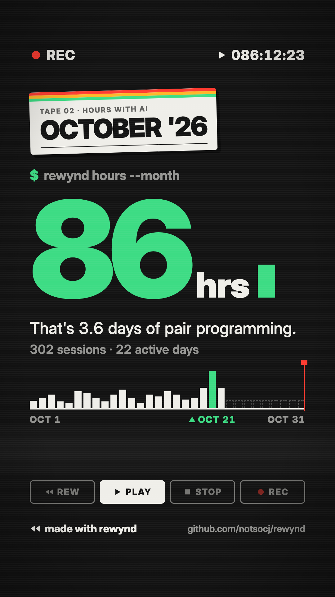
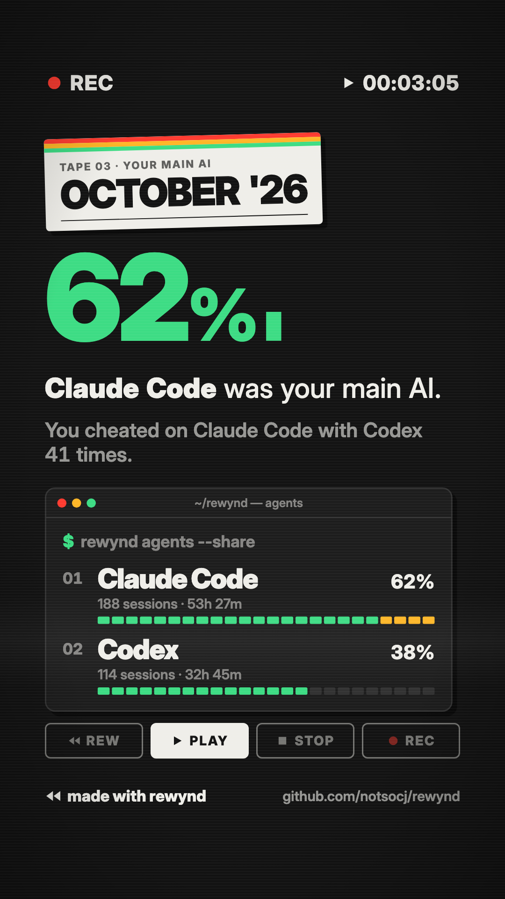
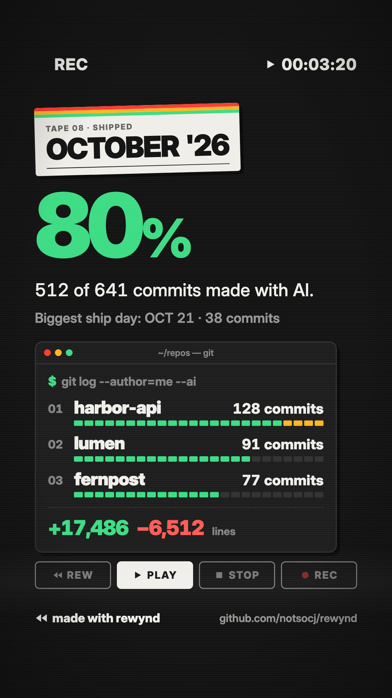
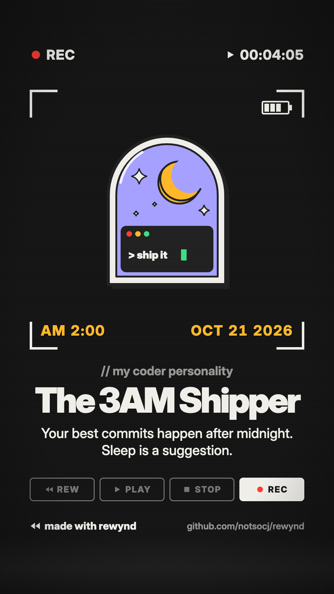

# ◀◀ rewynd

**Your month of AI coding, as a video.**

rewynd reads your local **Claude Code, Codex, Gemini CLI and OpenCode** history and turns it into a short "tape rewind meets terminal" recap video: hours, your main AI, your peak hour, top projects, what you shipped, and a coder personality. Claude writes the funny parts. Everything runs on your machine.

<p>
  
  
  
  
</p>

<sub>Sample frames rendered from fake data.</sub>

> **rewynd never changes your agent settings, never stores your messages, and only keeps daily totals in its own folder.**

---

## Install

You need **Node.js 22.18 or newer** (`node --version`).

```bash
npx skills add https://github.com/notsocj/rewynd --skill rewynd
```

That's the [skills CLI](https://skills.sh). It works with Claude Code, Codex, Cursor, Gemini CLI, OpenCode and other agents, and asks which ones to install for. Add `-g` to install it for all your projects. Then ask your agent for `/rewynd` (or just "make my rewynd").

The first render downloads the video template's dependencies and a headless browser once (about a minute). After that it runs offline.

<details>
<summary>Other ways to install</summary>

**Claude Code plugin**

```
/plugin marketplace add notsocj/rewynd
/plugin install rewynd@rewynd
```

**From a clone (for development)**

```bash
git clone https://github.com/notsocj/rewynd && cd rewynd
npm run rewynd -- collect --month 2026-10   # saves your days + writes output/stats.json
npm run rewynd -- status
```

The story part needs an agent to write `output/story.json`; see [skills/rewynd/SKILL.md](skills/rewynd/SKILL.md).

</details>

## Commands

It's one skill with four modes:

| Say | What it does |
|---|---|
| `/rewynd` | Pick a month (or year) → save new days → your agent writes your story → you pick a look → render the video |
| `/rewynd card` | Same, but one shareable image instead of a video |
| `/rewynd status` | What's saved, what's still on disk, and when Claude Code will delete your oldest transcript |
| `/rewynd setup` | Optional. Explains the 30-day deletion and saves your first days. Changes no settings |

Options: a month (`2026-09`), `--year 2026`, and `--github` (see below).

## ⚠ Claude Code deletes your history after 30 days

By default Claude Code permanently deletes session transcripts older than 30 days (`cleanupPeriodDays`). It's a deliberate security default, because transcripts can contain code and secrets.

**rewynd doesn't touch that setting.** Instead, every time you run any rewynd command it saves **one small summary per day** into its own `data/` folder. Once a day is saved, it counts in every future recap, even after the transcript is gone.

**So: run `/rewynd` or `/rewynd status` at least once every 30 days**, and your December recap covers your whole year.

## What rewynd reads, stores and shows

### Reads (read-only, never modified)

| Agent | Where | Status |
|---|---|---|
| Claude Code | `~/.claude/projects/**/*.jsonl` (or `$CLAUDE_CONFIG_DIR`) | ✅ |
| Codex | `~/.codex/sessions/**/rollout-*.jsonl` and `.jsonl.zst` (or `$CODEX_HOME`) | ✅ |
| Gemini CLI | `~/.gemini/tmp/*/chats/` (or `$GEMINI_DATA_DIR`) | ✅ |
| OpenCode | `$XDG_DATA_HOME/opencode/` (`opencode.db` or `storage/`) | ✅ beta |
| Cursor | `…/Cursor/User/globalStorage/state.vscdb` | 🔜 detected, support later |
| Antigravity | `~/.gemini/antigravity/` | 🔜 detected, support later |
| git | the repos you worked on with AI (for "What you shipped") | ✅ |

Logs are streamed line by line, so huge histories are fine (tested on ~14 GB). Databases are opened read-only. Background runs (auto-reviews, sub-agents, tools driving an agent) are counted separately and never inflate "sessions you started"; they only feed one joke line.

### Stores: `data/` (daily totals only)

```
data/
├── days/2026-10-21.json   # one file per day
├── coverage.json          # which dates rewynd has seen, per agent
└── preferences.json       # your design choices
```

A day file holds **counts only**: sessions, your message count, tool use by type ("Edit files", "Run commands"...), minutes active per hour, model names, project folder **names**, agent switches, counts of phrases like "please" / "still broken", and commit counts. **Never** message text, code, file contents, commit messages, emails or full paths. `data/` is git-ignored, and rewynd warns loudly if git ever starts tracking it.

### Shows Claude

Only two small files in `output/`:
- `stats.json`: the numbers above for the chosen period
- `samples.json`: **only after you say yes**, about 150 of your own messages, cut to 280 characters, with secrets, emails, keys and home paths removed

Claude never reads raw logs. A script checks the story before rendering, and **every number in it must exist in `stats.json`**.

### Network

None, with one opt-in exception: **`--github`** adds merged PRs, releases and new stars. It runs only when you ask, only through your existing `gh` login (`gh auth status`), read-only. rewynd never asks for, reads or stores a token. All of it lives in one file: [github.ts](skills/rewynd/scripts/shipped/github.ts).

(The **first** render also downloads the video template's dependencies and a headless browser, once. That's installing software, not sending your data anywhere.)

## Where your data lives (and keeping it across updates)

| Installed as | `data/` lives in | Survives updates? |
|---|---|---|
| `npx skills add` | `~/.rewynd/data/` | ✅ Yes. `npx skills update` replaces the skill folder, so your history lives outside it, in `~/.rewynd` |
| Claude Code plugin | `~/.claude/plugins/data/rewynd-rewynd/data/` (`${CLAUDE_PLUGIN_DATA}`) | ✅ Yes. ⚠ `/plugin uninstall` deletes it unless you pass `--keep-data` |
| git clone | `<repo>/data/` | ✅ `git pull` never touches it. ⚠ Don't delete and re-clone the folder |
| anywhere | `$REWYND_DATA_DIR/data/` if you set it | ✅ You choose |

Skill and plugin updates replace the installed folder, so rewynd never keeps your history inside it. Switching install methods? `/rewynd status` finds days saved by an older install and offers to copy them over (copy, never move, never shrinking a saved day).

**Delete everything rewynd saved:** delete that `data/` folder (and `output/`).

## Your look

Before rendering, rewynd asks once and remembers the answers:
- **Theme**: Auto (matches your personality), Night, Blue screen, Midnight, or Tape label
- **Font**: Inter, or your own font file (only copied locally for the render)
- **Format**: vertical 9:16 (TikTok / Reels / Stories), wide 16:9 (X / YouTube), or both
- **Hide project names**: shows "Project A / B / C" instead (client work stays private)
- **Music**: none by default. Add your own audio file if you like. rewynd ships no music

## How the numbers work

- **Active time** counts minutes where you or your agent were working: gaps up to 15 minutes count, and agent activity counts up to 60 minutes after your last message (an agent looping overnight doesn't count as your time). Parallel sessions count once.
- **Your main AI** is based on active time, not session count.
- **What you shipped** counts your commits (your git emails only) that reached the default branch. "Made with AI" means a `Co-Authored-By: Claude …` or `Copilot` trailer, or, for Codex (which leaves no trailer), the commit's hash was printed in a Codex session, it was made on a `codex/*` branch, or it landed during your Codex session in that repo. Line counts skip lockfiles, build output and minified files.

## Development

```bash
npm install            # dev tools only (TypeScript); rewynd has no runtime dependencies
npm test               # node:test, synthetic fixtures, never reads your real history
npm run typecheck
cd skills/rewynd/video && npm install && npx remotion studio   # preview the video template
```

- **Everything rewynd runs lives in [skills/rewynd/](skills/rewynd/)** (`scripts/`, `contract/`, `video/`), because `npx skills add` copies only that folder. A test fails if anything in it imports a file from outside it.
- Node runs the TypeScript in `skills/rewynd/scripts/` directly (type stripping): no build step.
- [contract/recap.ts](skills/rewynd/contract/recap.ts) is the shared contract between the scripts and the video.
- [rewynd-context.md](rewynd-context.md) has the full design notes; [DESIGN.md](DESIGN.md) has the visual system.
- Every file is commented in plain language. Please keep it that way.

## License

MIT. The video uses [Inter](https://rsms.me/inter/) (SIL Open Font License). Agent names are shown as plain text: rewynd isn't affiliated with Anthropic, OpenAI, Google, OpenCode or Cursor.
